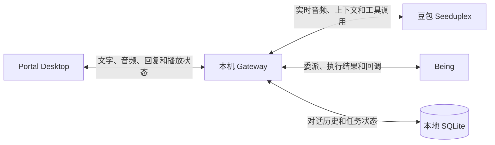

# Gateway 架构与对话上下文

本文面向维护 Gateway 和 Portal Desktop 的开发者。用户在同一场景里可以打字、说话、补充要求和管理任务，对话中的身份始终是当前的 Being。用户可见的回复用第一人称说明当前请求的状态或结果，模型分工、输入链路、队列、记忆存储和工具标识留在内部。

## 一 组件分工

| 组件 | 职责 |
| --- | --- |
| **Portal Desktop** | 展示聊天和任务状态，采集麦克风音频，播放回复并回传播放状态，提供当前配对的 Town 名。 |
| **Gateway** | 处理本机接口，组织同场景上下文，执行工具，管理统一任务队列，将结果送到界面和播报通道。 |
| **豆包 Seeduplex** | 处理实时语音识别、对话和发声，按共用规则调用工具，也为任务结果生成播报音频。 |
| **Being** | 执行实际查询和操作，处理身份变更及长期记忆，返回回复流和可关联的后台回调。 |



Gateway 由 Desktop 管理。同一个 Being 端点使用一套本地数据目录，按 `scene_id` 区分对话和任务。文字聊天可独立运行。开启通话后，Gateway 另外建立到豆包的实时连接。

键盘文字直达 Being；语音走 Being 代理，用 Loom token 认证。

## 二 两种输入共用的路由

豆包加载 [默认人设](../gateway/resources/ASSISTANT.md)、[路由规则](../gateway/resources/ROUTING-PROMPT.md)、[Being 产品知识](../gateway/resources/BEING-PROMPT.md)、[长期记忆规则](../gateway/resources/MEMORY-PROMPT.md)和[实时语音交互规则](../gateway/resources/PROMPT.md)。键盘文字不经过本机模型。Gateway 在本轮运行上下文中提供实际显示名。

| 用户意图 | 处理方式 |
| --- | --- |
| “你好”“围炉是什么”“刚才说的第二条是什么” | 根据当前对话或共用知识直接回答。 |
| “你是谁”“你叫什么” | 用当前 Town 名简短回答身份。 |
| “现在还有其他任务吗”“那项任务做到哪了” | 用 `get_agent_task_status` 查当前场景的实际状态。 |
| “刚才那项查 GPU”“取消这个任务” | 分别用 `update_agent_task` 或 `cancel_agent_task` 操作同一任务。 |
| “查一下我的私信”或需要联网查询、操作环境、制作交付物 | 用 `spawn_thinking` 将完整原话委派给 Being。 |
| “记住我喜欢简洁回答”“学习这套流程，以后照着做”“以后你叫小红”“忘记这件事” | 单独的身份或长期记忆写入用 `update_being_memory` 委派给 Being。 |
| 查询长期记忆，或同一轮既写入记忆又查询或做其他工作 | 用 `spawn_thinking` 将整轮原话委派一次，由 Being 返回实际结果。 |

上表是语音里豆包的路由。键盘打出的每一句都直接进入 Being，不在本机回答或查任务。

同一轮既问产品概念又要求执行时，豆包可以直接解释概念，同时委派实际工作。委派保留原话里的指代和条件，由 Being 结合上下文核实。委派成功后的结果来自 Being 的回复流，工具受理信息留在内部。委派工具明确失败时，豆包简短说明原因。

## 三 文字与语音链路

### 文字

1. Desktop 调用 Gateway 的 `POST /api/heart/chat/stream`，传入 `message`、`scene_id` 和 `client_request_id`。Gateway 按请求 ID 去重，记录本轮可取消的任务。
2. 若同场景正在通话，Gateway 通过 `playback.clear` 打断当前播放和旧语音回复。Being 已接到的工作继续运行。其他场景的文字请求不打断当前通话。随后 Gateway 捕获本轮上下文，再保存原文。
3. Gateway 把本轮上下文拼进原文，直接 POST 给 Being 的 `api/chat/stream`。附件随原文一起送出。
4. Being 的回复流由 Gateway 转给 Desktop。

例如，Desktop 可以提交以下请求。这句话原样进入 Being 的对话。

```json
{
  "message": "查一下我的私信",
  "scene_id": "inbox",
  "client_request_id": "req-003"
}
```

文字的等待时间就是 Being 受理和回复的时间。

### 语音

1. Desktop 连接 `/api/realtime`，持续发送麦克风音频。Gateway 将音频转给豆包，并在本地检测用户开口，及时打断正在播放的回复。
2. 豆包返回识别增量和最终转写。增量可显示为字幕。确认后的转写进入统一历史，任务工具以本轮确认原话为准。被文字打断后迟到的旧轮最终转写可以补入原轮历史，仅供理解后续对话。
3. 豆包直接生成对话回复和音频。需要委派时，豆包先自然地简短接话，再在同一轮立即调用工具。Gateway 将受理回执交回豆包，把 Being 的实际结果交给豆包播报。
4. Desktop 回传 `playback.started`、`playback.ended` 或 `playback.cancelled`。普通插话或打字可以停止声音，已完成的任务结果仍可在聊天历史中查看。

## 四 统一任务队列

### 委派与补充要求

两个模型通过 Gateway 的同一组任务工具操作 `TaskManager`。普通委派入队时保存原话、场景、轮次和上下文快照。轮到任务时，Gateway 等待 Being 当前活动流结束，再向 Being 的 `POST /api/chat/stream` 提交任务。执行状态可从 `queued` 进入 `running`，再结束为 `completed`、`failed` 或 `cancelled`。任务交给子代理后可处于 `delegated`，等待相关回调。

| 用户补充的内容 | 处理方式 |
| --- | --- |
| 修正同一个任务，尚未提交给 Being | 就地更新原任务，保留原任务 ID。执行时把最新修正放在正文开头，同时带上原要求和此前修正。 |
| 修正同一个任务，Being 已在处理 | 校验原任务流和场景后，直接将补充发给 Being，无需等待普通队列。HTTP 202 表示修正已接收，实际采用情况以 Being 的结果为准。发送结果未知时保留记录，避免重复提交。 |
| 另加一项独立工作 | 委派新任务，原任务继续。 |
| 原任务已结束或目标有歧义 | 先核实任务状态或询问必要信息，再按实际情况处理。 |

任务正文从原话开始，再附加 `<conversation_context>`。其中 `currentRequest.taskId` 和 `turnId` 对应任务与原轮次。发送时会按最新的同步记录筛选原快照，排队期间的新对话留给后续请求或明确的任务修正。

### 查询当前任务

“现在有哪些任务”“还有几个任务”“还有其他任务吗”都用 `get_agent_task_status` 的 `list_all: true`。活动总数看 `active_count`，排队数看 `queued_count`。不指定任务 ID 的单项查询以最近的活动任务为准。明确查询某一项时，可用任务 ID 核实历史状态。

文字流的取消请求受理后，状态查询仍可看到这项工作。等待回执时为 `cancelling`，停止未确认时为 `stop_unconfirmed`，可以再次取消。收到停止确认或原流自然结束后退出活动列表。已取消的后台委派任务继续从活动列表隐藏。

### 取消、回调与播报

1. **确定原任务。** Gateway 使用该轮语音开口或文字受理时记录的同场景可取消目标。单一目标可直接取消，多个目标有歧义时先澄清。任务使用 `task_id`。升级前仍在运行的旧直发文字流兼容 `stream_id`。
2. **受理即停发。** Gateway 先标记目标为丢弃输出，清除该任务的待播内容和已归档结果，屏蔽迟到的受理、更新、结果和重连回放。Desktop 按任务关联移除结果文字，Gateway 停止或撤回对应音频。若目标已在取消请求处理期间结束，但仍属于本轮可取消的交付目标，Gateway 仍会撤回它的输出，保留真实的执行状态。
3. **单独记录停止结果。** 后台确认停止后，文字流可发出 `stream_stopped`。已丢弃回复、停止尚未确认时，使用 `stream_discarded` 表示已停止接收回复。取消工具的 `accepted` 表示已受理。Desktop 按 `taskId` 或同场景 `chatStreamId` 合并任务状态与文字流，以一条任务记录呈现。
4. **按任务处理回调。** Gateway 约每两秒检查 Being 的 `/api/stream/active`，按回调中的任务标识、子任务归属或内部 `gateway-task` 标记及场景关联原任务。内部标记在展示前移除。归档、回放和播报都根据已确认的归属过滤被取消的任务，其他任务的回调继续交付。任务记录裁剪后仍保留取消归属所需的标记。

Desktop 的「停止处理」通过 `POST /api/heart/stop` 针对当前文字流。接口等待任务停止确认，当前流不匹配或停止尚未确认时可返回 HTTP 409。

普通任务结果进入历史。通话仍在同场景、语音输出开启且通道空闲时，Gateway 可将待播文字交给豆包，语音播报和聊天文字都以实际任务结果为来源。播报文本有长度上限，默认 6,000 字符，结果正文保留在历史中。仅写入长期记忆的任务省略常规自动播报。

### 断线恢复

Desktop 断开时，已受理的后台读取可以继续。重连时，Desktop 用 `GET /api/heart/stream/active?after=…` 补读当前本地流，也可从本地历史读取已归档结果。Gateway 与 Being 断线后，只续读可关联的原任务流。如果普通委派收到 HTTP 202 却没有可关联的结果流，或原流已不可回放，Gateway 保留已知投递状态并提示核对，避免自动重复提交。Being 的活动流接口仅提供最近可回放的流。

## 五 对话记录和上下文

### 本地记录

- `history.sqlite3` 保存按场景归档的用户文字、确认的语音转写、回复和任务结果，也保存文字流恢复所用的状态和回放事件。Desktop 通过 `/api/local-history` 读取对话，`/api/heart/history` 是兼容入口。通话归档记录文字和播放状态，原始音频用于实时传输。
- `gateway.sqlite3` 保存实时会话的近期记录、运行事件、任务队列和 Being 背景的同步进度。对话上下文使用本机记录构建。
- Desktop 首次加载某个 Being 的历史或场景列表时，可从旧 IndexedDB 分批迁入已缓存的消息。迁入记录标为 `legacy-desktop`，Gateway 按旧消息的服务端序号去重。

### 快照与增量

| 字段 | 内容 |
| --- | --- |
| `messages` | 按入库序号从本场景和未绑定场景的 Being 回调中选取最近 40 条作为候选，跳过空正文和未确认的转写。每条最多 4,000 字符，正文合计最多 20,000 字符。先从新到旧分配字数，再按从早到晚发送，保留已有的轮次、任务和播放信息。 |
| `tasks` | 同场景最近 10 个任务的摘要，目标最多 2,000 字符。帮助模型理解指代，当前任务状态以查询工具为准。 |
| `textWork` | 兼容旧的直发文字流等非路由流的状态。新文字委派的任务在 `tasks` 中记录。 |

文字模型收到本轮原话和选中的近期背景。豆包在建立会话时通过 `session.create` 收到背景，通话中可通过 `session.update` 更新，并用 `conversation.item.create` 补充变化项。

Being 收到与任务一起提交的背景。Gateway 按端点、场景及显式指定的上游会话 ID 记录同步进度。首次发送用 `snapshot: true`，之后只补上新增或变化的内容。已确认送达的原话、目标和完整结果按归属去重。有效回复流或接收回执到达后才确认同步，较旧的迟到回执不会覆盖较新的同步记录。`memory: []` 用于撤回旧版 Gateway 附带的本地记忆背景，长期记忆由 Being 管理。

例如，先打字说“我们把这版方案叫青松，周五前定稿”，再开口说“把刚才那个方案整理成三条待办”。前一句保存在本地，后一句委派时，Being 可以从同场景的背景里理解“刚才那个方案”。任务还在执行时，再打字说“第二条改成周四完成”，可以按原任务发送修正。

## 六 身份与长期记忆

### 当前身份

Desktop 优先使用当前配对 Town 的通讯录显示名，通讯录名称暂不可用时使用 Town 连接或本地配对提供的名称。文字请求通过百分号编码的 `X-Portal-Being-Name` 请求头传递，语音通过 `being_name` 随握手和后续音频消息传递。两个模型从 `<runtime_context>.being_name` 使用同一个名字。没有可用 Town 名时，Gateway 使用 Being 状态接口的显示名。

只问“你是谁”或“你叫什么”时，用一句话回答“我是某某，你的 Being。”，其中“某某”替换为实际名称。两处都没有名称时，回答“我是 Being。”。Desktop 后续携带更新后的名称时，Gateway 刷新当前身份，活跃的豆包会话以新名称重建。

### 长期记忆

本轮表达偏好和刚聊过的内容可以从当前对话直接沿用。正式改名、记住或学习信息、保存长期偏好、纠正或遗忘长期记忆，都由 Being 处理。

单独的写入请求先用“好呀”这类短句接话，再调用 `update_being_memory`。工具受理后结束接话，明确失败时说明原因。实际写入或改名以 Being 的执行结果为准。查询长期记忆通过 `spawn_thinking` 交给 Being，根据返回内容回答。

## 七 目标架构

### 最终状态

语音模型与后台大模型共享同一套权重、分词器和一条 token 序列，因此共享同一份 KV cache，包括尚未说出口的 latent reasoning。语音侧生成到专用 token 时，不另起一次文本委派，而是由大模型从该 cache 继续生成。thinking 段不进入语音解码；只把要对用户说的 token 交给语音解码器。

跨模型不能交接 KV cache。豆包 Seeduplex 与 Being 的层宽、分词和音频嵌入都不同，当前实现只传递任务原文和有界会话快照。

### 过渡方案

过渡期两个模型保持独立。后台是现有 Agent：大模型、系统提示词，以及分级记忆。认知、设定、性格和价值观常驻后台上下文。精确记忆压成长期、中期、近期摘要，按需检索后再放入上下文，也可以用工具主动写入。

前端语音模型的上下文大约是后台的十分之一，负责短回复，并把复杂执行、长期精确记忆的检索和写入委派给后台。体验上，语音模型要对模糊记忆和用户的基本设定立即作答，这类回答与后台使用常驻设定时的回答一致；精确事实仍等检索结果。

当前 Gateway 还没有常驻设定卡，也没有长、中、近摘要。语音侧只看到人设与路由提示、Being 显示名，以及最近 40 条、正文合计最多 2 万字的会话快照。发给 Being 的背景会带上 `memory: []`，用来撤回旧的本机记忆，长期记忆仍只在 Being 内。因此「你是谁」可以立即回答，「我是谁」这类已在历史里出现过的身份仍可能被当成新的记忆查询。
